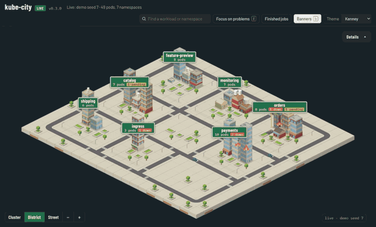

# kube-city

A living isometric city of your Kubernetes cluster. Namespaces are
districts, workloads are buildings, and pods coming and going make the city
grow, burn and rebuild, live.



- **In your browser.** `kube-city` opens the city in your browser (WebGL,
  mouse-wheel zoom, search, details on click). The old terminal view
  (`--tui`) was removed in 0.4.0.
- **Read-only.** It only lists and watches pods, Services, Ingresses and
  Gateway routes, the way `kubectl get pods -w` does, and never changes
  anything in the cluster.
- **Big clusters stay readable.** Zoom out to one district per namespace,
  coloured by health; zoom in for buildings, then names and individual pods.
  Infrastructure namespaces form an industrial quarter, branch namespaces
  (`feature-`, `bugfix-`) the suburbs, everything else the town centre. A
  river with bridges runs between the suburbs and the middle of town.
- **Problems stand out.** Crashing workloads burn, pending ones are
  construction sites, failed ones are burnt-out shells; `f` fades everything
  that is healthy.

## Install

Linux (macOS builds are paused, see #80):

```bash
curl --proto '=https' --tlsv1.2 -LsSf https://github.com/braveadmin/kube-city/releases/latest/download/kube-city-installer.sh | sh
```

Windows (PowerShell):

```powershell
powershell -ExecutionPolicy Bypass -c "irm https://github.com/braveadmin/kube-city/releases/latest/download/kube-city-installer.ps1 | iex"
```

Homebrew (Linux):

```bash
brew install braveadmin/tap/kube-city
```

With Rust: `cargo install kube-city`.

As a kubectl plugin (`kubectl city`), link it under a name kubectl
looks for, in a directory on your `PATH`:

```bash
ln -s "$(command -v kube-city)" ~/.local/bin/kubectl-city
```

Or download an archive for your platform from the
[releases page](https://github.com/braveadmin/kube-city/releases).

The binaries are not signed. On macOS, `cargo install kube-city` works
until macOS builds return (#80).

## Use

```bash
kube-city                               # current kubectl context, in the browser
kube-city --context my-cluster          # another context
kube-city -n shop -n payments           # only these namespaces
kube-city --demo                        # a simulated cluster, no cluster needed
```

kube-city serves the city on `http://127.0.0.1:7700/` (`--port` to change
it) and opens it in your browser; under WSL that is the Windows browser.
`--no-open` only prints the address. The page stays live while it is open; a
page opened later, or one that lost the connection, gets the whole city
again. (`--web` still works; it is the default now.)

On a remote machine, forward the port and open the city locally:
`ssh -L 7700:127.0.0.1:7700 server`, then run `kube-city --no-open` on the
server and open `http://127.0.0.1:7700/` on your computer.

In the browser: scroll or pinch to zoom through three levels (cluster,
district, street), drag to pan, hover for details, click a building for its
pods and the same component in other namespaces. Keys: arrows pan, `+` `-`
zoom, `c` fits the city, `/` searches, `f` fades healthy buildings, `i`
folds the details panel away, `b` hides the name banners (handy in crowded
districts), `Esc` clears. The header shows which version is running. The **Theme** dropdown switches
between Kenney (sprites) and Metropolis (drawn in code). When the city shows
a cluster, the **Context** dropdown switches to any other context in your
kubeconfig without restarting (not while `--record` is saving).

Every cluster gets a world of its own: the land round the town grows from
a seed, which the page picks the first time it shows a context and keeps in
your browser for that context (the demo and replays have one each). The
**World** section of the details panel shows the seed; type another one, or
press **New world** for a random one. The seed also picks the kind of land:
a valley, a coast, an island with a harbour, lake country or highlands. The
style dropdown below the seed picks one for you instead, and **New world**
then keeps it; the legend names the style and the seed. Both stay in the
browser and never reach kube-city or a recording, so another browser, or
clearing the site's data, gives a new world.

`--record city.jsonl` saves everything that happens and `--replay
city.jsonl` plays it back later (`--replay-speed 10` for ten times faster):
handy for showing a cluster without access to it. Recordings contain your
namespace and workload names.

`--anonymise` replaces every name (namespaces, workloads, pods, nodes,
images, contexts) with a made-up one before it leaves kube-city: in the
page, in the status line, in the **Context** dropdown and in `--record`
files. Use it for screenshots, talks and recordings you want to share; it
also anonymises an old recording played with `--replay`. Namespaces every
cluster has (`kube-system`, `default`) and well-known infrastructure
(`cert-manager`, `argocd`, …) keep their names, and other infrastructure
namespaces the part that marks them (`gitlab-…`, `…-system`), so the city
keeps its industrial quarter. The made-up names
are new every run; `--anonymise-salt SECRET` keeps them the same between
runs (keep the salt secret, or names could be matched by guessing).
The page keeps its world under the made-up context name, so without
`--anonymise-salt` the world is new every run too.

### What it needs

- A kubeconfig: `KUBECONFIG` (all listed files, merged like kubectl does) or
  `~/.kube/config`. Exec plugins such as `kubelogin` or `aws eks get-token`
  work; kube-city connects before it starts, so login prompts show up as
  plain text.
- Permission to `list` and `watch` pods, in all namespaces or in the ones
  you pass with `-n`. For shops, the same for Services, Ingresses and (if
  the cluster has the Gateway API) HTTPRoutes and GRPCRoutes; without it
  the city runs without shops and the status line says so.
- A browser with WebGL. The page is served only on 127.0.0.1 and needs
  no internet: PixiJS, the sprites and the fonts are in the binary.

## The browser city

| Kubernetes        | Kenney look                                  |
|-------------------|----------------------------------------------|
| Namespace         | A block with its name on a road sign         |
| Deployment        | Office block, taller the more its pods request |
| StatefulSet       | Brick hall with a tank on the roof, taller the same way |
| DaemonSet         | House with a pitched roof                    |
| Job               | Works with a chimney, smoking while it runs  |
| Pod without owner | Kiosk                                        |
| Pending           | Dug foundation with a crane                  |
| Crashing          | On fire (CrashLoopBackOff, ImagePullBackOff and similar) |
| Failed            | Burnt-out shell                              |
| Terminating       | Fading                                       |
| Reached from outside | Shop front with an awning at street level |

One building stands for one workload; zoom to street level for one dot per
pod. Offices and brick halls get two storeys for every doubling of the CPU
and memory their pods request (4 GiB counts as a core), from 2 storeys at
0.1 core up to 12, and the heaviest stand in the middle of their block, so
each neighbourhood has its skyscrapers in the centre. Without requests
(older recordings), offices grow a storey per replica. Workloads reached
from outside the cluster (behind an Ingress, a Gateway route, a
LoadBalancer or a NodePort Service) are shops: they keep their shape, get
a shop front, and stand on the neighbourhood's street facing the middle of
town. Click a building to see its pods: name, readiness, restarts, age, node
and, in red, why a pod is not simply running (ImagePullBackOff, OOMKilled,
Evicted, …), plus the workload's images and how it is reached from outside. A workload looks the same, and stands in the same spot, in every
namespace that has it, so environments that deploy the same stack are easy
to compare.

## Questions, ideas and bugs

- Questions and ideas: [Discussions](https://github.com/braveadmin/kube-city/discussions).
- Bugs: [issues](https://github.com/braveadmin/kube-city/issues), with your
  kube-city version (`kube-city --version`), operating system and browser.
- Security problems: report them privately, see [SECURITY.md](SECURITY.md).
- What is planned: [ROADMAP.md](ROADMAP.md).

## Development

```bash
cargo run --release -- --demo   # browser view of the simulated cluster
cargo test
cargo clippy --all-targets
```

The browser page is `art/city.template.html`; `src/web.rs` serves it.
`docs/decisions.md` records how the project got here and why.

## License

kube-city is licensed under either of [Apache License 2.0](LICENSE-APACHE) or
[MIT license](LICENSE-MIT), at your option.

It includes:

- Sprites from Kenney's *Isometric Buildings* and *Isometric City* packs
  (CC0, [kenney.nl](https://kenney.nl)), in `assets/kenney/`.
- [PixiJS](https://pixijs.com) 7.4.2 (MIT, see `assets/pixi/LICENSE`).
- The Barlow, Barlow Condensed and IBM Plex Mono fonts (SIL Open Font
  License, see `assets/fonts/`).
