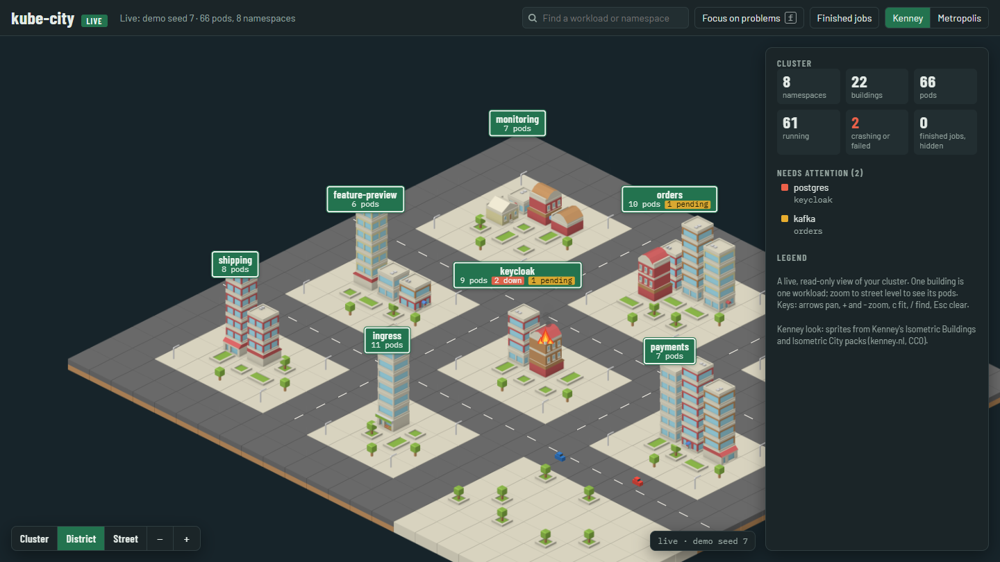

# kube-city

A living isometric city of your Kubernetes cluster. Namespaces are
districts, workloads are buildings, and pods coming and going make the city
grow, burn and rebuild, live.



- **One binary, two views.** `kube-city --web` opens the city in your browser
  (WebGL, mouse-wheel zoom, search, details on click); plain `kube-city`
  draws it in the terminal.
- **Read-only.** It only lists and watches pods, the way `kubectl get pods -w`
  does, and never changes anything in the cluster.
- **Big clusters stay readable.** Zoom out to one district per namespace,
  coloured by health; zoom in for buildings, then names and individual pods.
- **Problems stand out.** Crashing workloads burn, pending ones are
  construction sites, failed ones are burnt-out shells; `f` fades everything
  that is healthy.

## Install

Linux and macOS:

```bash
curl --proto '=https' --tlsv1.2 -LsSf https://github.com/braveadmin/kube-city/releases/latest/download/kube-city-installer.sh | sh
```

Windows (PowerShell):

```powershell
powershell -ExecutionPolicy Bypass -c "irm https://github.com/braveadmin/kube-city/releases/latest/download/kube-city-installer.ps1 | iex"
```

Or download an archive for your platform from the
[releases page](https://github.com/braveadmin/kube-city/releases), or build
it yourself with Rust: `cargo install --git https://github.com/braveadmin/kube-city`.

The binaries are not signed. On macOS, if Gatekeeper refuses to open a
downloaded binary, run `xattr -d com.apple.quarantine kube-city` once.

## Use

```bash
kube-city --web                         # current kubectl context, in the browser
kube-city --web --context my-cluster    # another context
kube-city --web -n shop -n payments     # only these namespaces
kube-city --web --demo                  # a simulated cluster, no cluster needed
kube-city                               # the terminal view
```

`--web` serves the city on `http://127.0.0.1:7700/` (`--port` to change it)
and opens it in your browser; under WSL that is the Windows browser.
`--no-open` only prints the address. The page stays live while it is open; a
page opened later, or one that lost the connection, gets the whole city
again.

In the browser: scroll or pinch to zoom through three levels (cluster,
district, street), drag to pan, hover for details, click a building for its
pods and the same component in other namespaces. Keys: arrows pan, `+` `-`
zoom, `c` fits the city, `/` searches, `f` fades healthy buildings, `i`
folds the details panel away, `Esc` clears. The **Theme** dropdown switches
between Kenney (sprites) and Metropolis (drawn in code). When the city shows
a cluster, the **Context** dropdown switches to any other context in your
kubeconfig without restarting (not while `--record` is saving).

`--record city.jsonl` saves everything that happens and `--replay
city.jsonl` plays it back later (`--replay-speed 10` for ten times faster):
handy for showing a cluster without access to it. Recordings contain your
namespace and workload names.

### What it needs

- A kubeconfig: `KUBECONFIG` (all listed files, merged like kubectl does) or
  `~/.kube/config`. Exec plugins such as `kubelogin` or `aws eks get-token`
  work; kube-city connects before it starts, so login prompts show up as
  plain text.
- Permission to `list` and `watch` pods, in all namespaces or in the ones
  you pass with `-n`.
- For `--web`, a browser with WebGL. The page is served only on 127.0.0.1;
  it loads its fonts from Google Fonts and falls back to system fonts
  without internet. Everything else (PixiJS, sprites) is in the binary.

## The browser city

| Kubernetes        | Kenney look                                  |
|-------------------|----------------------------------------------|
| Namespace         | A block with its name on a road sign         |
| Deployment        | Office block, a storey per replica           |
| StatefulSet       | Brick hall with a barrel roof                |
| DaemonSet         | House with a pitched roof                    |
| Job               | Works with a chimney, smoking while it runs  |
| Pod without owner | Kiosk                                        |
| Pending           | Dug foundation with a crane                  |
| Crashing          | On fire (CrashLoopBackOff, ImagePullBackOff and similar) |
| Failed            | Burnt-out shell                              |
| Terminating       | Fading                                       |

One building stands for one workload; zoom to street level for one dot per
pod. A workload looks the same, and stands in the same spot, in every
namespace that has it, so environments that deploy the same stack are easy
to compare.

## The terminal city

Drawn in the Metropolis theme: daylight pixel art in the spirit of SimCity
2000. Each image pixel is half a terminal cell (`▀` with true colour).

Run `kube-city` without `--web`; it needs a true-colour terminal. Keys:
arrows / `hjkl` pan, `z` cycles detail, overview and map, `f` fades healthy
buildings, `c` re-centres, `q` / `Esc` / `Ctrl+C` quit. If the watch drops,
the status bar says so and it reconnects.

| Kubernetes          | City                                                       |
|---------------------|------------------------------------------------------------|
| Namespace           | District: one or more blocks of 4×4 lots, with its own ground colour |
| Deployment pod      | Office tower; workload sets colour, height and setbacks    |
| StatefulSet pod     | Storage tank, twin tanks or silo, coloured per workload    |
| DaemonSet           | One house for all its pods, showing the worst state        |
| Job pod             | Factory with a smoking chimney                             |
| Pod without owner   | Kiosk                                                      |
| Free lot            | Lawn or trees                                              |

| Pod state           | Building                                                   |
|---------------------|------------------------------------------------------------|
| Pending             | Construction site with a working crane                     |
| Running             | Lit windows that switch on and off over time               |
| CrashLoopBackOff    | Fire and smoke on the roof, glowing windows                |
| Terminating         | Faded, partly demolished, with dust                        |
| Succeeded / Failed  | Counted in the status bar / scorched pavilion with a red cross |

CrashLoopBackOff covers every container stuck waiting for help:
ImagePullBackOff, ErrImagePull, CreateContainerConfigError and similar.

A workload looks the same in every namespace, so a component deployed in many
namespaces is recognisable everywhere. `--all-pods` shows every pod as its own
building, finished jobs (pavilions with a green tick) included.

The map zoom draws each building as a small tile coloured by state, so a big
cluster fits on screen and problems show as red spots.

Every pod keeps its lot for its whole life. Blocks are handed out along a
spiral around the centre, so the city grows outwards; a block that empties
goes back to the city.

## Themes

`src/render/theme/` holds the looks. The renderer decides what stands where
and in which order things are drawn; a `Theme` paints ground, buildings and
free lots with the primitives in `src/render/scene.rs` (boxes, walls with
window patterns, pitched roofs, round solids), and works at both zooms.
Metropolis is the only theme so far. `art/samples.py` renders the three
candidate styles (Metropolis, Neon night, Toy town) as reference images:
`python3 art/samples.py art/out`.

## Questions, ideas and bugs

- Questions and ideas: [Discussions](https://github.com/braveadmin/kube-city/discussions).
- Bugs: [issues](https://github.com/braveadmin/kube-city/issues), with your
  kube-city version (`kube-city --version`), operating system and browser.
- Security problems: report them privately, see [SECURITY.md](SECURITY.md).

## Development

```bash
cargo run --release -- --web --demo   # browser view of the simulated cluster
cargo test
cargo clippy --all-targets
```

The browser page is `art/city.template.html`; `src/web.rs` serves it.
`docs/decisions.md` records how the project got here and why.

## License

kube-city is licensed under either of [Apache License 2.0](LICENSE-APACHE) or
[MIT license](LICENSE-MIT), at your option.

It includes:

- Sprites from Kenney's *Isometric Buildings* and *Isometric City* packs
  (CC0, [kenney.nl](https://kenney.nl)), in `assets/kenney/`.
- [PixiJS](https://pixijs.com) 7.4.2 (MIT, see `assets/pixi/LICENSE`).

The page uses the Barlow, Barlow Condensed and IBM Plex Mono fonts from
Google Fonts (SIL Open Font License).
